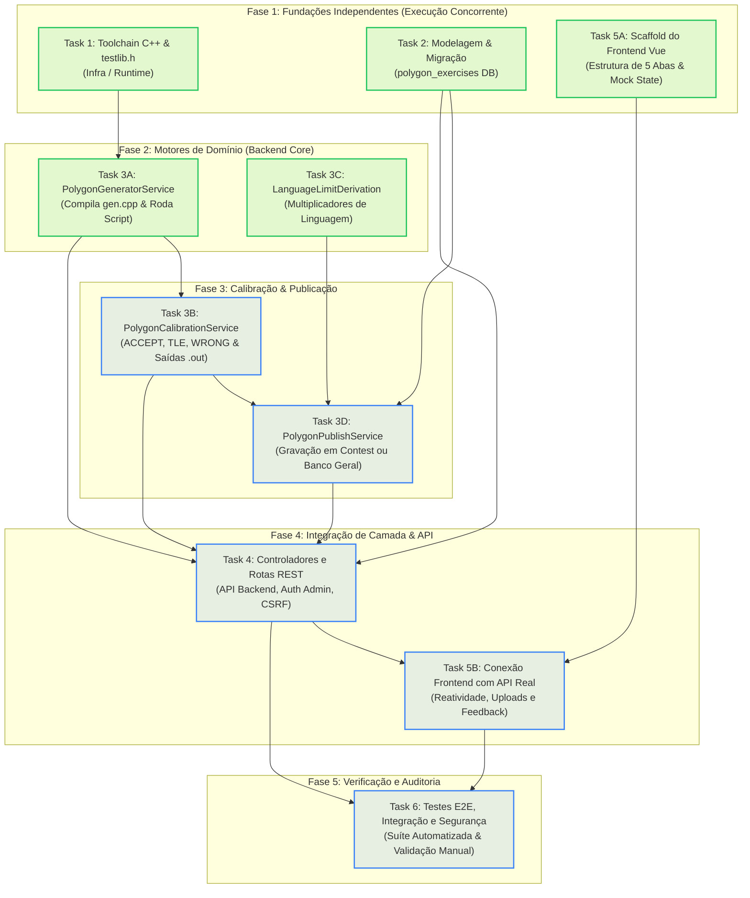
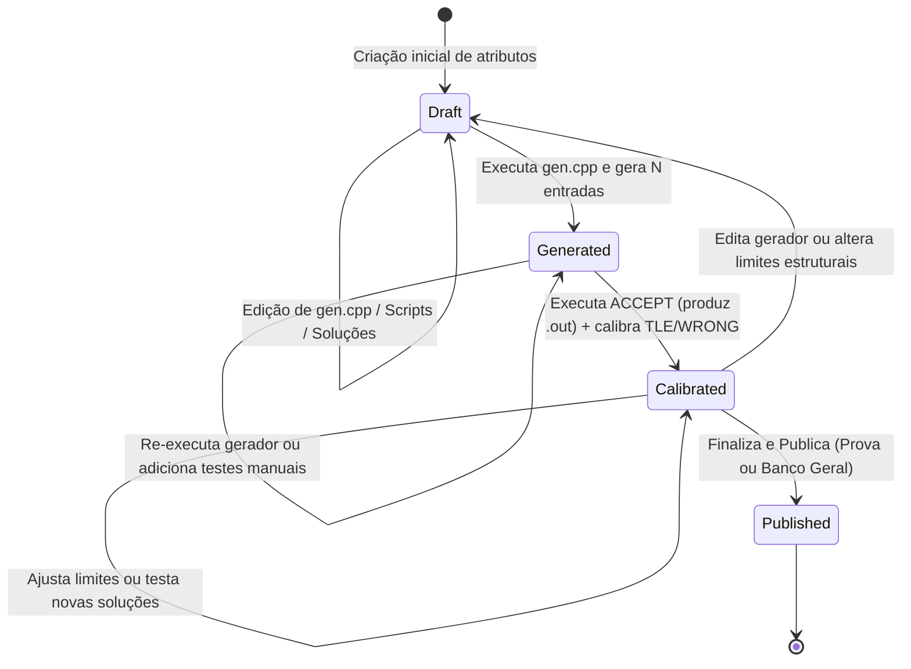

# 401 — Sistema de Criação e Calibração de Exercícios (Estilo Polygon / Codeforces)

## 1. Visão Geral e Motivação

O **microHelium** historicamente importava exercícios prontos através de pacotes ZIP (formato BOCA no `#34` ou pacotes ICPC/Kattis no `#200/#233`), ou cadastrava problemas básicos com apenas um caso de teste de exemplo no `problem_bank` (`#46`).

Não existia uma ferramenta nativa de **autoria e calibração de problemas**, em que o professor ou organizador da prova pudesse:
1. Escrever o gerador de casos de teste determinístico em C++ com a biblioteca padrão de maratonas (`testlib.h`).
2. Passar parâmetros para gerar $N$ casos de teste automáticos via scripts (sintaxe padrão do Polygon: `gen <args> > $`).
3. Fornecer uma solução modelo (**ACCEPT**, obrigatória) que compila, executa contra todos os casos gerados e **produz as saídas oficiais (`.out`)**, garantindo que o problema é solucionável dentro dos limites estabelecidos.
4. Enviar soluções intencionais de teste:
   - **TLE (Time Limit Exceeded)**: para calibrar os limites e confirmar que os testes barram algoritmos ineficientes (ex: $O(N^2)$).
   - **WRONG (Wrong Answer)**: para calibrar que os testes cobrem casos de borda e pegam soluções com falhas lógicas ou gulosas ingênuas.
5. Calibrar ou derivar automaticamente limites para **todas as linguagens da plataforma** (ex: Python 3.0x de tempo, Java 2.0x + startup), persistindo em `problem_language_limits`.
6. Publicar o problema pronto:
   - Em uma **competição específica** (criando registros em `problems`, `test_cases` e os arquivos em `storage/app/problems/{contest_id}/{basename}/`).
   - Ou no **Banco de Problemas geral (`problem_bank`)**, preservando o pacote completo com todos os $N$ testes em `storage/app/problem_bank/{code}/` para uso em qualquer competição futura.
7. Garantir **isolamento seguro** (execução contida via `bwrap`, limites estritos de CPU/memória) e **acesso 100% restrito a administradores**.

---

## 2. Grafo de Orquestração Fullstack e Paralelismo

A implementação é dividida em **6 Tarefas Modulares**, organizadas em fases para permitir execução paralela de componentes desacoplados:



### Matriz de Dependências das Tarefas

| Tarefa | Nome do Componente | Pode rodar em paralelo com? | Depende de quem? |
|---|---|---|---|
| **Task 1** | Toolchain C++ & `testlib.h` | Task 2, Task 5A | Nenhuma |
| **Task 2** | Modelagem & Migrações | Task 1, Task 5A | Nenhuma |
| **Task 3A** | `PolygonGeneratorService` | Task 3C | Task 1 |
| **Task 3B** | `PolygonCalibrationService` | Task 3C | Task 3A |
| **Task 3C** | `LanguageLimitDerivationService` | Task 3A, Task 3B | Nenhuma |
| **Task 3D** | `PolygonPublishService` | Nenhuma | Task 2, Task 3B, Task 3C |
| **Task 4** | Controllers e API REST | Nenhuma | Task 2, Task 3A, 3B, 3C, 3D |
| **Task 5A** | Scaffold UI (5 Abas Vue) | Task 1, Task 2 | Nenhuma (usa mocks) |
| **Task 5B** | Integração Frontend ➔ API | Nenhuma | Task 4, Task 5A |
| **Task 6** | Suíte de Testes e Segurança | Nenhuma | Task 4, Task 5B |

---

## 3. Modelo de Dados e Ciclo de Vida

### Tabela `polygon_exercises`

Os exercícios em desenvolvimento ficam salvos em um workspace dedicado para que o administrador possa editar o gerador, os scripts e as soluções iterativamente sem expor problemas incompletos na prova.

```sql
CREATE TABLE polygon_exercises (
    id BIGINT UNSIGNED AUTO_INCREMENT PRIMARY KEY,
    contest_id BIGINT UNSIGNED NULL, -- Se null: destino é Banco Geral (problem_bank)
    name VARCHAR(200) NOT NULL,
    short_name VARCHAR(10) NOT NULL,
    basename VARCHAR(100) NOT NULL,
    time_limit INT NOT NULL DEFAULT 1, -- Tempo base em segundos (C++)
    memory_limit INT NOT NULL DEFAULT 256, -- Memória base em MB
    output_limit INT NOT NULL DEFAULT 1024, -- Limite de saída em KB
    description LONGTEXT NULL, -- Enunciado Markdown
    input_description LONGTEXT NULL,
    output_description LONGTEXT NULL,
    notes LONGTEXT NULL,
    color_name VARCHAR(50) NULL,
    color_hex VARCHAR(7) NULL,
    
    -- Código do Gerador e Scripts de Teste
    generator_source LONGTEXT NULL, -- Código C++ de gen.cpp
    generator_script LONGTEXT NULL, -- Linhas: gen <args> > $
    manual_tests JSON NULL, -- [{ "input": "...", "output": "...", "is_sample": true }]
    
    -- Códigos de Solução para Calibração
    solution_accept LONGTEXT NULL, -- C++ modelo (obrigatório)
    solution_tle LONGTEXT NULL,    -- C++ / Python / etc. lenta (opcional)
    solution_wrong LONGTEXT NULL,  -- C++ / etc. com bug (opcional)
    additional_solutions JSON NULL,-- [{ "lang": "py3", "type": "accept", "source": "..." }]
    
    -- Estado e Resultados
    status ENUM('draft', 'generated', 'calibrated', 'published') NOT NULL DEFAULT 'draft',
    calibration_results JSON NULL, -- Relatório completo de tempos, consumos e vereditos
    published_problem_id BIGINT UNSIGNED NULL,
    published_bank_code VARCHAR(50) NULL,
    created_by BIGINT UNSIGNED NOT NULL,
    
    created_at TIMESTAMP NULL,
    updated_at TIMESTAMP NULL,
    
    FOREIGN KEY (contest_id) REFERENCES contests(id) ON DELETE SET NULL,
    FOREIGN KEY (published_problem_id) REFERENCES problems(id) ON DELETE SET NULL,
    FOREIGN KEY (created_by) REFERENCES users(id) ON DELETE CASCADE
);
```

### Máquina de Estados do Exercício



### Layout de Arquivos em Disco

1. **Workspace Temporário de Execução (`storage/app/temp/polygon_{id}/`)**:
   - `gen.cpp`: arquivo fonte do gerador.
   - `gen`: executável compilado via g++.
   - `tests/`:
     - `001.in`, `002.in`, ..., `NNN.in`: entradas produzidas pelo gerador ou manuais.
     - `001.out`, `002.out`, ..., `NNN.out`: saídas oficiais produzidas pela solução ACCEPT.
   - `solutions/`:
     - `accept.cpp` / `accept.bin`
     - `tle.cpp` / `tle.bin`
     - `wrong.cpp` / `wrong.bin`
2. **Destino Prova (`storage/app/problems/{contest_id}/{basename}/`)**:
   - `input/`: cópia de todos os arquivos `.in` renomeados sequencialmente (`001`, `002`...).
   - `output/`: cópia de todos os arquivos `.out` oficiais (`001`, `002`...).
   - `description/statement.md` (se exportado).
3. **Destino Banco Geral (`storage/app/problem_bank/{code}/`)**:
   - `input/` e `output/` com o pacote completo de $N$ casos de teste preservados. Quando o problema for importado via "Adicionar do Banco" (`ContestWizardController::addProblemsFromBank`), o sistema copia todos os $N$ casos reais, e não apenas o exemplo inicial.

---

---

## 4. Arquitetura da Interface do Usuário (UI/UX)

A interface do Polygon segue estritamente o **Princípio da Responsabilidade Única (SRP)** e o princípio de **Progressive Disclosure** (Nielsen Norman Group), dividindo o ecossistema em duas telas desacopladas:

```
[Administração]
       │
       ▼
[GET /backend/polygon] ──────────► [Modal "+ Novo Exercício"]
(Dashboard / Gestão / KPIs)                 │
       │                                    ▼ (POST /api/backend/polygon)
       │ Clique "Abrir Workspace"           │ Redirecionamento
       ▼                                    ▼
[GET /backend/polygon/{id}] ◄───────────────┘
(Workspace Dedicado em 5 Etapas)
```

### 4.1 Tela de Visão Geral / Dashboard (`/backend/polygon`)
- **Objetivo**: Gestão do inventário de problemas, métricas de autoria, busca, filtros e fluxo inicial de criação rápida.
- **Componente**: `resources/js/features/PolygonDashboard.vue` montado via `resources/views/backend/polygon/index.blade.php`.
- **Cards de Métricas (KPIs)**:
  - Total de problemas, Rascunhos (`draft`), Casos Gerados (`generated`), Calibrados (`calibrated`) e Publicados (`published`).
  - Cada card atua como filtro de seleção rápida.
- **Barra de Ferramentas**:
  - Campo de busca instantânea (debounced) por nome, sigla ou slug.
  - Pílulas de filtro de status (*Todos, Rascunho, Gerado, Calibrado, Publicado*).
  - Seletor de destino (*Todos, Banco Geral ou Prova Específica*).
- **Tabela de Problemas**:
  - Exibe sigla estilizada com a cor do balão, nome com link direto para o workspace, slug, destino, limites de execução e badge de status.
  - Ações por linha: botão primário **Abrir Workspace →** e botão de exclusão permanente com diálogo modal de confirmação.
- **Modal "+ Novo Exercício"**:
  - Acessível (com aprisionamento de foco, fechamento por `Esc` e validação).
  - Campos mínimos essenciais: Nome, Sigla, Slug em disco (auto-gerado), Destino, Limites base (1s / 256MB) e Cor do balão.
  - Cria atomicamente o registro via `POST /api/backend/polygon` e redireciona o autor para `/backend/polygon/{id}`.

### 4.2 Workspace de Autoria e Calibração (`/backend/polygon/{id}`)
- **Objetivo**: Estúdio imersivo e dedicado exclusivamente à edição, geração de testes, calibração e publicação do exercício `{id}`.
- **Componente**: `resources/js/features/PolygonWorkspace.vue` montado via `resources/views/backend/polygon/workspace.blade.php`.
- **Diretrizes de UI/UX e Carga Cognitiva**:
  - **Zero Poluição / Sem Mocks**: O estado reativo inicial é limpo (`null`/vazio), hidratado exclusivamente com os dados reais do exercício `{id}` via API.
  - **Breadcrumb de Retorno**: Botão `← Voltar ao Painel` permanente no topo para navegação fluida.
  - **Microcopy & Progressive Disclosure**: Eliminação de paredes de texto instrucionais redundantes em prol de rótulos concisos, tooltips discretos `(?)` e placeholders intuitivos.
  - **Terminal Colapsável (Drawer)**: O console de compilação C++ fica recolhido por padrão, expandindo-se automaticamente apenas quando houver falhas ou mediante clique do usuário.
  - **Accordion de Linguagens**: A matriz de limites derivados por linguagem na Aba 4 fica agrupada em gaveta expansível.

### 4.3 Pipeline de 5 Etapas do Workspace

#### Etapa 1: Atributos & Enunciado
- **Metadados Estruturados**: Nome, sigla, slug, limites base (tempo/memória), cor do balão e destino.
- **Enunciado Estruturado**: Editor com modos *Lado a Lado*, *Apenas Editor* e *Preview*, campos de Entrada, Saída e Notas.
  - Lista de competições ativas e futuras (`contests`).
- **Campos de Metadados**:
  - `name`: Título do problema (ex: *"Resto da Divisão"*).
  - `short_name`: Código na prova (ex: `A`, `B`...) ou sigla no banco.
  - `basename`: Identificador único / slug para pasta em disco (ex: `resto-divisao`).
  - `time_limit`: Tempo base em segundos (default `1s`).
  - `memory_limit`: Memória base em MB (default `256MB`).
- **Enunciado Estruturado**:
  - Editor Markdown com preview em tempo real.
  - Campos dedicados para **Entrada**, **Saída** e **Notas**.
  - Seleção de cor do balão (`color_name` e `color_hex`).

### Aba 2: Gerador (`gen.cpp`)
- Editor de código em C++ pré-populado com o template base do `testlib.h`:
  ```cpp
  #include "testlib.h"
  #include <iostream>

  using namespace std;

  int main(int argc, char* argv[]) {
      registerGen(argc, argv, 1);

      long long limite_n = atoll(argv[1]);
      long long limite_m = atoll(argv[2]);

      long long n = rnd.next(0LL, limite_n);
      long long m = rnd.next(1LL, limite_m); 

      cout << n << " " << m << endl;
      return 0;
  }
  ```
- **Botão "Compilar Gerador"**:
  - Aciona compilação imediata em sandbox:
    `g++ -O2 -std=c++20 -static -I resources/judge-runtime/include gen.cpp -o gen`
  - Painel de logs exibindo saída do compilador (erros e avisos destacados com número de linha).

### Aba 3: Geração de Testes (Script & $N$ Casos)
- **Editor de Script de Testes**:
  - Aceita linhas com comandos:
    ```text
    gen 5 10 > $
    gen 10 50 > $
    gen 1000 5000 > $
    gen 5000 10000 > $
    gen 100000 1000000000 > $
    ```
  - Regra de parsing: cada linha é executada como `./gen <args>`, e o token `$` indica que a saída padrão deve ser capturada no próximo número sequencial de teste (`1`, `2`, `3`...).
- **Seção de Testes Manuais & Amostra**:
  - Tabela para inclusão de casos manuais (ex: o caso de teste exibido no enunciado da prova).
  - Checkbox `is_sample` (marca se o caso deve ser público para os competidores no enunciado).
- **Botão "Executar Geração de Testes"**:
  - Executa o executável `gen` para cada linha do script sob sandbox com timeout de 5s por teste.
  - Tabela interativa listando os $N$ casos gerados:
    - Número do caso, origem (Script ou Manual), tamanho da entrada em bytes e botão para inspecionar o conteúdo.

### Aba 4: Soluções & Calibração (ACCEPT, TLE, WRONG)
- **Solução ACCEPT (Modelo / Gabarito)**:
  - Linguagem principal: **C++ (C++20)** — obrigatória.
  - Compila e executa sobre todos os $N$ testes gerados.
  - **Gera os arquivos `.out` oficiais** para todos os casos de teste.
  - Mede tempo máximo de CPU e pico de memória.
- **Solução TLE (Time Limit Exceeded)**:
  - Opcional. Código propositalmente ineficiente.
  - Executada contra os testes. Deve estourar o limite de tempo em pelo menos um caso.
  - **Diagnóstico**: Se passar em todos, exibe alerta: *"Atenção: a solução TLE passou em todos os testes. Recomenda-se aumentar os limites dos casos de teste ou reduzir o time_limit"*.
- **Solução WRONG (Wrong Answer)**:
  - Opcional. Código com lógica falha ou caso de borda negligenciado.
  - Executada contra os testes. Deve produzir saída divergente da solução ACCEPT em pelo menos um caso.
  - **Diagnóstico**: Se passar em todos, exibe alerta: *"Atenção: a solução WRONG passou em todos os testes. Adicione casos de teste específicos para cobrir este caso de borda"*.
- **Calibração Multi-Linguagem & Derivação**:
  - O usuário pode adicionar soluções em outras linguagens ativas no microHelium (ex: Python 3, Java).
  - Se adicionadas, o sistema afere o tempo real de execução.
  - Se omitidas, o sistema deriva os limites a partir do C++:
    - **C / C++**: 1.0x (base).
    - **Python**: 3.0x do tempo base (mínimo de 1s para startup).
    - **Java / Kotlin**: 2.0x do tempo base + 1.0s de startup de JVM e +128MB de RAM.
    - **JavaScript / Node**: 2.0x do tempo base.
  - Matriz visual exibindo os limites resultantes por linguagem (`problem_language_limits`).

### Aba 5: Finalização & Envio
- **Checklist de Prontidão**:
  - [ ] Metadados válidos preenchidos
  - [ ] Gerador C++ compilado
  - [ ] Ao menos 1 caso de teste gerado ($N \ge 1$)
  - [ ] Solução ACCEPT passou em 100% dos testes e produziu saídas oficiais
  - [ ] Status de calibração TLE/WRONG revisado
- **Ação de Finalização**:
  - Botão **"Finalizar e Publicar"**:
    - **Cenário A (Com competição selecionada)**:
      - Insere registro em `problems` vinculado ao `contest_id`.
      - Copia os arquivos de `input/` e `output/` para o storage permanente da prova.
      - Insere os registros em `test_cases` (com hash SHA-256 e flags `is_sample`).
      - Grava os limites derivados em `problem_language_limits`.
      - Registra em `ContestLog`.
    - **Cenário B (Sem competição selecionada - Banco Geral)**:
      - Insere registro em `problem_bank`.
      - Salva o pacote de testes completo em `storage/app/problem_bank/{code}/input/` e `output/`.
  - Feedback de sucesso e redirecionamento para visualização do problema pronto!

---

## 5. Especificação dos Contratos de API (REST / JSON)

Todas as rotas são restritas pelo middleware `['auth', 'admin']` e exigem o token CSRF (`X-CSRF-TOKEN`) para requisições mutativas (`POST`, `PUT`, `DELETE`).

### Endpoints Principais

| Método | Rota | Descrição | Status Sucesso |
|---|---|---|---|
| `GET` | `/api/backend/polygon` | Lista todos os rascunhos de exercícios | `200 OK` |
| `POST` | `/api/backend/polygon` | Cria um novo rascunho de exercício | `201 Created` |
| `GET` | `/api/backend/polygon/{id}` | Retorna detalhes completos do rascunho | `200 OK` |
| `PUT` | `/api/backend/polygon/{id}` | Salva alterações (metadados, código, scripts) | `200 OK` |
| `DELETE` | `/api/backend/polygon/{id}` | Remove um rascunho | `204 No Content` |
| `POST` | `/api/backend/polygon/{id}/compile-generator` | Compila o gerador `gen.cpp` | `200 OK` |
| `POST` | `/api/backend/polygon/{id}/generate-tests` | Executa script e gera $N$ casos de teste | `200 OK` |
| `POST` | `/api/backend/polygon/{id}/calibrate` | Executa calibração de soluções (ACCEPT, TLE, WA) | `200 OK` |
| `POST` | `/api/backend/polygon/{id}/publish` | Publica o problema na prova ou banco geral | `200 OK` |

### Exemplo de Payload: Salvar Rascunho (`PUT /api/backend/polygon/{id}`)

```json
{
  "contest_id": 1,
  "name": "Resto da Divisão",
  "short_name": "A",
  "basename": "resto-divisao",
  "time_limit": 1,
  "memory_limit": 256,
  "description": "# Enunciado...",
  "input_description": "Dois inteiros N e M.",
  "output_description": "Imprima PAR ou IMPAR e o resto.",
  "notes": "1 <= N, M <= 10^9",
  "color_name": "Azul",
  "color_hex": "#3B82F6",
  "generator_source": "#include \"testlib.h\"...",
  "generator_script": "gen 5 10 > $\ngen 10 50 > $\n",
  "manual_tests": [
    { "number": 1, "input": "4 3\n", "output": "PAR\n1\n", "is_sample": true }
  ],
  "solution_accept": "#include <iostream>...",
  "solution_tle": "",
  "solution_wrong": ""
}
```

### Exemplo de Resposta: Calibração (`POST /api/backend/polygon/{id}/calibrate`)

```json
{
  "data": {
    "status": "calibrated",
    "summary": {
      "total_tests": 5,
      "accept_passed": true,
      "max_time_seconds": 0.04,
      "max_memory_mb": 14.2,
      "tle_calibrated": true,
      "wrong_calibrated": true
    },
    "cases": [
      {
        "number": 1,
        "is_sample": true,
        "input_bytes": 8,
        "output_bytes": 12,
        "accept": { "verdict": "AC", "time": 0.01, "memory": 12.0 },
        "tle": { "verdict": "AC", "time": 0.01 },
        "wrong": { "verdict": "WA", "match": false }
      },
      {
        "number": 5,
        "is_sample": false,
        "input_bytes": 25,
        "output_bytes": 18,
        "accept": { "verdict": "AC", "time": 0.04, "memory": 14.2 },
        "tle": { "verdict": "TLE", "time": 1.05 },
        "wrong": { "verdict": "WA", "match": false }
      }
    ],
    "language_limits": [
      { "language": "cpp", "name": "C++ (G++ 15)", "time_limit": 1, "memory_limit": 256, "source": "measured" },
      { "language": "python3", "name": "Python 3", "time_limit": 3, "memory_limit": 256, "source": "derived_3x" },
      { "language": "java", "name": "Java 21", "time_limit": 3, "memory_limit": 384, "source": "derived_jvm" }
    ]
  }
}
```

---

## 6. Fichas Técnicas das Tarefas (Roadmap de Execução)

### [Task 1] Toolchain C++ & Inclusão do `testlib.h`
- **Responsabilidade**: Disponibilizar a biblioteca `testlib.h` e validar o toolchain de compilação C++ sob o sandbox.
- **Arquivos Tocados**:
  - `[NEW] resources/judge-runtime/include/testlib.h` (versão master oficial).
  - `[NEW] tests/Unit/Polygon/TestlibCompilationTest.php`.
- **Critério de Aceite**: O teste automatizado compila com sucesso um programa C++ com `testlib.h` sob GCC 13+ com `-std=c++20`.

### [Task 2] Modelagem de Dados & Migrações
- **Responsabilidade**: Criar tabela para persistência dos exercícios do Polygon e o Model Eloquent correspondente.
- **Arquivos Tocados**:
  - `[NEW] database/migrations/2026_10_15_000001_create_polygon_exercises_table.php`.
  - `[NEW] app/Models/PolygonExercise.php`.
  - `[NEW] database/factories/PolygonExerciseFactory.php`.
  - `[NEW] tests/Unit/Polygon/PolygonExerciseModelTest.php`.
- **Critério de Aceite**: Migração executa e reverte no SQLite e MySQL. Model trata corretamente casts JSON e relacionamentos.

### [Task 3] Motores de Domínio do Polygon
- **Responsabilidade**: Implementar os serviços responsáveis por compilação, parsing de scripts, geração de entradas, julgamento de calibração e publicação.
- **Arquivos Tocados**:
  - `[NEW] app/Services/Polygon/PolygonGeneratorService.php` (parser de `gen <args> > $`, compilação e execução).
  - `[NEW] app/Services/Polygon/PolygonCalibrationService.php` (executa ACCEPT gerando saídas oficiais, afere TLE e WRONG).
  - `[NEW] app/Services/Polygon/LanguageLimitDerivationService.php` (cálculo de multiplicadores e regras de derivação).
  - `[NEW] app/Services/Polygon/PolygonPublishService.php` (gravação atômica na prova ou no banco de problemas).
  - `[NEW] tests/Integration/Polygon/PolygonGeneratorServiceTest.php`.
  - `[NEW] tests/Integration/Polygon/PolygonCalibrationServiceTest.php`.
- **Critério de Aceite**: Gerador de exemplo produz 5 casos; ACCEPT produz 5 saídas e obtém AC; TLE proposital resulta em TLE; WRONG proposital resulta em WA.

### [Task 4] Controladores e Endpoints REST (API Administrativa)
- **Responsabilidade**: Expor as operações do Polygon via endpoints seguros para o administrador.
- **Arquivos Tocados**:
  - `[NEW] app/Http/Controllers/Backend/PolygonExerciseController.php`.
  - `[NEW] routes/backend_api_polygon.php` (incluso em `routes/web.php`).
  - `[MODIFY] routes/web.php` (rota Blade `/backend/polygon`).
  - `[NEW] tests/Feature/Polygon/PolygonApiControllerTest.php`.
  - `[NEW] tests/Feature/Polygon/PolygonSecurityAuthorizationTest.php`.
- **Critério de Aceite**: Usuários sem role `admin` recebem 403 Forbidden em todos os endpoints. Administrador executa ciclo completo via API.

### [Task 5] Interface do Usuário (Vue 3 em 5 Abas)
- **Responsabilidade**: Desenvolver a interface visual fluida e interativa em 5 abas dentro do padrão de design do microHelium.
- **Arquivos Tocados**:
  - `[NEW] resources/views/backend/polygon/workspace.blade.php`.
  - `[NEW] resources/js/features/PolygonWorkspace.vue`.
  - `[MODIFY] resources/js/features/mount.js` (registro de `polygon-workspace`).
  - `[MODIFY] resources/views/layouts/app.blade.php` (link no menu de administração).
- **Critério de Aceite**: O administrador navega entre as 5 abas sem perda de dados, recebe feedback de progresso e conclui a criação com sucesso.

### [Task 6] Testes Ponta a Ponta & Homologação
- **Responsabilidade**: Validar todo o fluxo integrado (E2E), desde o rascunho inicial até o julgamento da solução de uma equipe real após a publicação.
- **Arquivos Tocados**:
  - `[NEW] tests/E2E/PolygonFullLifecycleTest.php`.
- **Critério de Aceite**: Um exercício criado no Polygon, com gerador e script, é publicado em uma prova real e o AutoJudgeService avalia submissões de equipes com 100% de precisão.

---

## 7. Critérios de Conclusão da Especificação

Esta especificação foi concluída e aprovada para guiar os orquestradores e desenvolvedores na implementação da funcionalidade, garantindo:
1. Alinhamento integral aos requisitos de negócio.
2. Contratos técnicos imutáveis entre Frontend, Backend e Sandbox.
3. Roteiro claro para paralelismo de tarefas e delegação autônoma.
